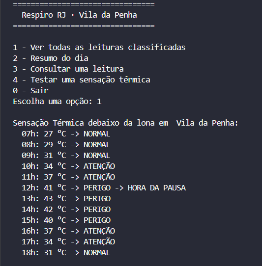

# Lógica · O Cérebro da CitizenTech

Parte de **Computational Thinking with Python** da CitizenTech *Respiro RJ*.

## O que o programa faz
 programa recebe as 12 leituras de sensação térmica de um dia de trabalho na barraca (das 7h às 18h) e classifica cada uma com `if/elif/else` nas mesmas faixas da Sentinela do Calor. Ele calcula o resumo do dia, encontra a maior sequência de horas seguidas em perigo e, quando ela chega a 1 hora, pede uma pausa ao ambulante, com os mesmos avisos do site.


## Como rodar

1. Instale o Python 3 (o mesmo usado nas aulas).
2. Abra esta pasta no terminal ou no PyCharm.
3. Rode:

```bash
python main.py
```

## De onde vêm os dados

- **Grandeza medida:** sensação térmica (índice de calor) debaixo da lona, em °C
- **Quantidade de registros:** 12 (uma leitura por hora, das 7h às 18h)
- **Origem:** simulados pela equipe; os mesmos valores usados em Matemática e na Sentinela do Wokwi

Leituras: 27, 29, 31, 34, 37, 41, 43, 42, 40, 37, 34, 31.

## Faixas de decisão

Os mesmos limites usados no circuito de Edge e os mesmos textos da página. Os limites seguem a tabela de índice de calor do Serviço Nacional de Meteorologia dos EUA (NWS/NOAA), convertida para °C.

| Faixa | Condição | Aviso para o cidadão | Sentinela |
|---|---|---|---|
| NORMAL | valor < 32 | Calor sob controle. Mantenha a água por perto. | LED verde |
| ATENÇÃO | 32 ≤ valor ≤ 39 | Calor forte. Beba água com frequência e ligue o ventilador. | LED amarelo |
| PERIGO | valor > 39 | Calor perigoso! Faça uma pausa na sombra e beba água. Se sentir tontura, peça ajuda. | LED vermelho |
| HORA DA PAUSA | 1 hora seguida em PERIGO | Você está há 1 hora em calor perigoso. Pare agora e procure um Ponto de Respiro. | LED vermelho piscando + bipe curto |
| LEITURA INVÁLIDA | valor < 0 ou valor > 60 | Sensor sem leitura. Confira o aparelho. | LED amarelo piscando |

O limite de 1 hora para a pausa é uma regra do projeto, não uma medida médica, e pode ser ajustado na variável `limite_pausa`.

## Resumo calculado

[O que a opção 2 mostra: média, maior valor, % de leituras em alerta e qualquer conta extra que a equipe criou.]

## Integração com as outras partes

| Parte | Como conversa com o Python |
|---|---|
| Sensor · Edge | Os 12 registros simulam as leituras da Sentinela do Calor no Wokwi; mesmas faixas, mesma regra de pausa e mesma leitura inválida |
| Experiência · TX Design | As faixas viram as regras de negócio (RN); as opções do menu saíram das histórias do ambulante |
| Interface · Front-end | As mensagens impressas são os textos da página |
| Interação · Web Dev | A regra de decisão foi reescrita em JavaScript (Interação 1: digitar a sensação térmica e ver o aviso) |
| Matemática | Os mesmos dados do dia formam a curva de sensação térmica e o tempo acima de 39 °C |
| Pitch · Storytelling | O programa rodando aparece no vídeo |

## Execução



## Antes de enviar

- [ ] O programa roda do início ao fim, e o menu só termina no **0 - Sair**
- [ ] A lista tem 10 ou mais registros do problema da equipe
- [ ] Cada registro é classificado com `if/elif/else`, com faixas que fazem sentido
- [ ] O resumo mostra média, maior valor e % de leituras em alerta
- [ ] Letra, número fora do menu e Enter vazio não derrubam o programa
- [ ] Faixas e avisos iguais aos do circuito e da página
- [ ] Este README está preenchido, com print, e o `prompts.md` está atualizado
- [ ] Todos os integrantes sabem explicar qualquer linha do `main.py`
